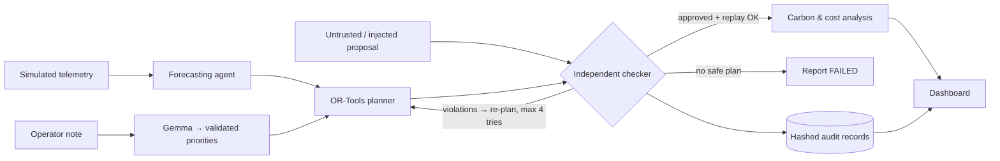

# SynapseGrid

**Verified renewable-energy dispatch for critical community loads, with an AI assistant that cannot override the safety checks.**

| | |
|---|---|
| **Category** | **Sustainability** (with a Social Good angle: keeping clinics, water and emergency communications powered) |
| **Prototype** | FastAPI app in [`app/`](app/), containerised for Google Cloud Run |
| **Google AI / Cloud** | Gemma (operator-context understanding) · Google OR-Tools (dispatch optimization) · Cloud Run (hosting) |
| **Live deployment** | _TODO: add Cloud Run URL after deploying (see [Deployment](#deployment))_ |
| **Demo video (3 min)** | _TODO: add public YouTube / Vimeo / Google Drive link_ |
| **Proposal deck (PDF)** | _TODO: add link_ |

> **What this is and isn't.** SynapseGrid is a **simulator**. It runs on a small, synthetic island microgrid. It does not connect to or control any real electrical equipment, and every number in the demo comes from simulated telemetry under stated assumptions.

---

## 1. Problem statement

Many remote and island communities get their electricity from small local grids ("microgrids") built around **diesel generators**. Diesel is expensive to ship in and emits CO₂, so these communities are adding **solar panels and batteries**.

That creates an operational problem. Solar output can change very quickly: a cloud front can remove most of a solar farm's output within minutes. When that happens, someone (an operator, or software) has to decide immediately how to cover the gap:

- how much to discharge each battery,
- whether to start or ramp up the diesel generator,
- which power lines will carry the extra flow,
- and, if there isn't enough power, which loads to cut, without ever cutting the clinic, the water pumps, or emergency radio.

A rushed or careless plan can do real damage. It can overload a power line, push a generator past its limits, or drain a battery below its safe level. And the plan doesn't have to be careless to be wrong. It may come from a buggy algorithm, a tired human, or an AI model that sounds confident.

Small operators rarely have tools that **check a proposed plan against the physical limits before it is acted on**, explain exactly why it is unsafe, and suggest a safe alternative.

**The question this project answers:** can we let fast planners, including AI, propose recovery actions after a sudden solar loss, while guaranteeing that nothing is dispatched unless it passes an independent check of every modeled physical limit, and while measuring the cost and carbon impact of each decision?

---

## 2. Solution

SynapseGrid is a dispatch assistant with three clearly separated roles:

| Role | What it does | Technology |
|---|---|---|
| **Understand the human context** | Reads the operator's free-text incident note (e.g. *"Cyclone warning; the school gym is the evacuation shelter until 18:00"*) and turns it into structured load priorities: which non-critical loads to protect and how to rank the rest. | **Gemma**, with strict JSON-schema validation; the output is treated as untrusted |
| **Plan** | Computes the cheapest, lowest-carbon dispatch that respects power balance at every bus, line limits, battery and generator limits, and the rule that critical loads are always fully served. | **Google OR-Tools** (linear programming, DC power-flow model) |
| **Decide** | An **independent checker** re-computes the physics from scratch and approves or rejects every proposal, whatever its source. If it rejects one, the exact violations go back to the planner and it tries again (at most 4 attempts). If no safe plan exists, it reports failure instead of dispatching something unsafe. | Plain Python, no shared code with the planner |

Every proposal, rejected or accepted, is saved as an **audit record** with a SHA-256 hash. Anyone can re-run the independent checker on a saved record and confirm they get the same verdict.

### What the demo shows (one click: "Run incident")

1. The synthetic island grid is running normally on about 96 % renewable energy.
2. A sudden cloud front removes **75 % of solar output (−1,836 kW)**.
3. A plausible-sounding but unsafe proposal is submitted: *"restart the diesel to cover everything and top up the port battery."*
4. The independent checker **rejects it** and says exactly why:
   - diesel genset at **2,699 kW** against its **2,000 kW** rating,
   - output change of **+2,699 kW** against a **600 kW** ramp limit,
   - power line L15 carrying **1,278 kW** against its **800 kW** limit. The checker computed this flow itself; it never trusts the planner's numbers.
5. The optimizer re-plans. The new plan passes **all 27 checks** and is dispatched.
6. The audit record replays to the same verdict.

A second button runs an **infeasible stress test**: night, no wind, nearly empty batteries and a diesel trip. The system reports **"RECOVERY FAILED — critical-load shortfall 564.8 kW"** and dispatches nothing. It does not hide the problem.

---

## 3. Impact

### Measured in the prototype (simulated data)

**The incident above:**

| | Before the cloud front | Rejected unsafe plan (never dispatched) | Certified recovery plan |
|---|---:|---:|---:|
| CO₂ emissions (kg/h) | 0 | 1,889 | **142** |
| Operating cost ($/h) | 1 | 873 | **86** |
| Critical loads served | 100 % | 100 % | **100 %** |
| Unmet demand (kW) | 0 | 0 | **0** |
| Renewable share | 96 % | 35 % | 35 % |

Compared with the rejected plan, the certified plan avoids about **1,750 kg CO₂ per hour** of the incident and costs about **$790/h less**, while keeping every critical load powered.

**Randomized fault testing:** 300 seeded scenarios, reproducible with `python app/evaluation.py --n 300 --seed 7`. Full output is in [`app/EVALUATION.md`](app/EVALUATION.md).

| Metric | Result |
|---|---|
| Scenarios where a safe plan existed / didn't | 273 / 27 |
| Recovered to a certified plan after an unsafe proposal was injected | **273 / 273** |
| Impossible scenarios reported as FAILED (never certified) | **27 / 27** |
| Certified plans that turned out to be unsafe | **0** |
| Adversarial and malformed proposals classified the same as a second, separately written checker | **2,400 / 2,400** |
| Recovery time, median / 95th percentile | 1.1 ms / 1.2 ms |

### How to read these numbers honestly

- All figures come from **simulated data** and **declared assumptions**: diesel 0.70 kg CO₂/kWh, $320/MWh diesel cost, and zero operational emissions for solar, wind and batteries. They are not field measurements.
- The emissions comparison is against the **rejected plan**, not against a real-world baseline.
- The second checker uses the same constraint definitions as the first. Agreement shows the code is **consistent**, not that the physics model is complete.
- "0 unsafe plans accepted" means **within the modeled constraints**. The model doesn't cover voltage, reactive power or transient stability.

### Who would benefit if this were developed further

- **Communities on island and remote microgrids:** fewer outages of critical services (clinics, water, telecom) during sudden renewable drops, and less diesel burned.
- **Microgrid operators:** a second pair of eyes that explains *why* a plan is unsafe, in plain constraint terms, before anything is switched.
- **Anyone adopting AI in infrastructure:** a concrete pattern where the AI handles messy human context but an independent, deterministic check has the final say.

---

## 4. Feasibility

- **It runs today.** The full prototype runs on a laptop or a 1-vCPU Cloud Run instance. The optimizer solves in about 0.2 ms and the checker runs in about 0.1 ms for this network.
- **Small, open dependencies.** FastAPI, Pydantic, httpx, Jinja2 and Google OR-Tools, all pinned in [`app/requirements.txt`](app/requirements.txt).
- **Tested.** 35 automated tests (`pytest`), covering:
  - valid plans
  - line overloads
  - battery limit and depletion
  - solar loss followed by recovery
  - honest failure
  - malformed and adversarial inputs
  - Gemma timeouts and invalid output (using mocked responses)
  - reproducibility
  - API validation
- **Works without the AI.** If Gemma is not configured, times out, or returns invalid output, the system says so and uses declared default priorities. Safety does not depend on the model.

## 5. Scalability

**Built to scale:**
- The network, assets and loads are plain data in [`app/grid.py`](app/grid.py). A different microgrid means a different data file, not new code.
- The optimizer and checker are linear-algebra and linear-programming workloads. They grow polynomially with network size, and real community microgrids are small.
- Each community could run its own isolated instance (one Cloud Run service per site).

**What would need to change for real deployment (not done):**
- **Telemetry:** real measurements (e.g. via Pub/Sub or IoT ingestion) instead of the simulator.
- **Look-ahead:** multi-period planning, so batteries aren't drained too eagerly.
- **Physics:** voltage and reactive-power checks.
- **Audit storage:** persistent audit storage (e.g. Firestore) instead of in-memory.
- **Validation:** with a utility partner and a domain engineer.

---

## 6. Development

### Architecture



| File | Purpose |
|---|---|
| [`app/grid.py`](app/grid.py) | Synthetic network, declared assumptions, telemetry simulator, fixed demo scenario |
| [`app/optimizer.py`](app/optimizer.py) | OR-Tools DC optimal power flow; the deterministic unsafe-proposal generator used in the demo |
| [`app/verifier.py`](app/verifier.py) | Independent checker (standard library only), structured violation records, replay CLI |
| [`app/gemma.py`](app/gemma.py) | Gemma client, output schema, honest status reporting |
| [`app/agents.py`](app/agents.py) | Agent contracts, execution trace, bounded recovery loop, audit ledger |
| [`app/evaluation.py`](app/evaluation.py) | Randomized fault evaluation |
| [`app/main.py`](app/main.py) | FastAPI server, REST API, live event stream |
| [`app/static/index.html`](app/static/index.html) | Dashboard |

The technical deep dive (optimization formulation, constraint list, audit-record format, API reference) is in [`app/README.md`](app/README.md).

### Run locally

```bash
cd app
python3.12 -m venv .venv && source .venv/bin/activate
pip install -r requirements-dev.txt
pytest -q                              # 35 tests
python evaluation.py --n 300 --seed 7  # randomized evidence
python main.py                         # open http://localhost:8080
```

### Enable Gemma (optional)

| Option | Set |
|---|---|
| Google AI Studio | `GEMMA_API_KEY=<your key>` (default model `gemma-3-27b-it`; override with `GEMMA_MODEL`) |
| Local Ollama | `GEMMA_BASE_URL=http://localhost:11434/v1  GEMMA_MODEL=gemma3:4b` |
| Self-hosted (vLLM, Cloud Run GPU) | `GEMMA_BASE_URL=https://<endpoint>/v1  GEMMA_MODEL=<name>` |

### Deployment

```bash
cd app
gcloud run deploy synapsegrid --source . --region asia-southeast1 --allow-unauthenticated \
  --port 8080 --cpu 1 --memory 1Gi --min-instances 1 --max-instances 1 --no-cpu-throttling --timeout 3600 \
  --set-secrets GEMMA_API_KEY=gemma-api-key:latest
```

Setting up the `gemma-api-key` secret is covered in [`app/README.md`](app/README.md#deploy-to-google-cloud-run). Run a single instance, because the simulator state lives in memory. Delete the service after judging to stop billing.

---

## 7. Known limitations

- **Simulation only.** The data is synthetic and the topology illustrative; there is no real-grid integration.
- **Simplified physics.** Lossless DC power flow over a single 15-minute interval. No voltage, reactive power, protection or stability modelling, and no multi-period look-ahead.
- **Assumed numbers.** Emission factors and costs are assumptions, stated in [`app/grid.py`](app/grid.py).
- **Gemma untested live.** Gemma has only been tested against mocked responses. A live call needs an API key or endpoint, then a manual check.
- **Unbuilt container.** The Docker image and the Cloud Run deployment have not yet been built or run by the author's tooling. The pinned requirements were verified in a clean Python 3.12 environment.
- **Not a formal proof.** A "certified" plan means every modeled constraint holds under the stated assumptions. The hash proves a record hasn't been altered; it does not prove the plan is safe in the real world.
