<p align="center">
  
</p>

<p align="center">
  
  
  
  
  
  <a href="https://github.com/souzataniya/SynapseGrid/actions/workflows/ci.yml"></a>
  
</p>

<h3 align="center">Verified renewable-energy dispatch for critical community loads</h3>
<p align="center"><i>Gemma reads the human context · Google OR-Tools plans · an independent verifier decides</i></p>

| 🌐 Live prototype | 🎬 Demo video (3 min) | 📑 Proposal deck (PDF) | 🏷️ Category |
|:---:|:---:|:---:|:---:|
| https://synapsegrid-608544134195.asia-south1.run.app/ | [▶ Watch on Loom](https://www.loom.com/share/5062c49df951400abe2b761341c9c24a) · [MP4](docs/video/SynapseGrid-Demo.mp4) | [PDF](SynapseGrid-Proposal.pdf) · [PPTX](SynapseGrid-Proposal.pptx) | **Sustainability** |

<p align="center">
  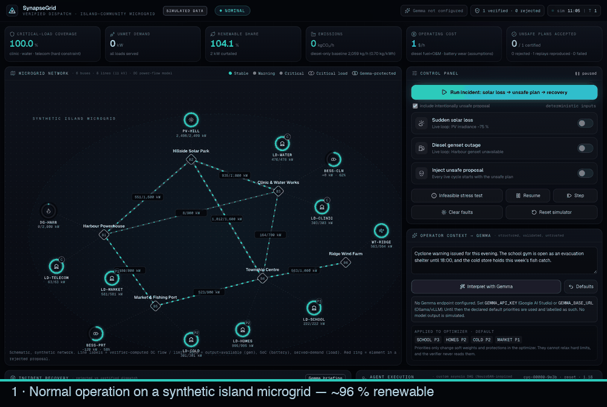
</p>

> [!IMPORTANT]
> SynapseGrid is a **simulator**. It runs on a small, **synthetic** island microgrid, never connects to or controls real electrical equipment, and every number below comes from simulated telemetry under stated assumptions.

---

## 📌 At a glance

| | |
|---|---|
| **The problem** | Island and remote communities are swapping diesel for solar + batteries, but solar can collapse in minutes. A rushed recovery plan can overload lines or cut power to the clinic. |
| **What we built** | A dispatch assistant where AI and optimizers may *propose*, but **nothing is dispatched unless an independent checker confirms every modeled physical limit**. |
| **Headline result** | After a 75 % solar loss, an unsafe plan is rejected with 3 exact violations. The re-plan passes 27/27 checks, keeps critical loads at 100 %, and emits **142 kg CO₂/h instead of 1,889**. |
| **Evidence** | 300 random fault scenarios: **0 unsafe plans accepted**, 273/273 recoverable cases recovered, 27/27 impossible cases honestly reported as failures. |

---

## 1. 🧩 Problem statement

Many remote and island communities get their electricity from small local grids built around **diesel generators**. Diesel is expensive to ship in and emits CO₂, so these communities are adding **solar panels and batteries**.

That creates a new operational problem. **Solar output can drop very quickly**: a passing cloud front can remove most of it within minutes. Someone has to decide, right away:

```text
☀️ ──▶ ☁️  solar drops 75 %
          │
          ├─ how hard can each battery discharge?
          ├─ how fast can the diesel generator ramp up?
          ├─ which power lines will carry the extra flow — and will they overload?
          └─ if there isn't enough power, what do we cut?  (never the clinic, water or emergency radio)
```

A careless plan can **overload a line, push a generator past its rating, or drain a battery below its safe level**. The plan might come from a buggy algorithm, a tired human, or an AI model that sounds confident.

Small operators rarely have a tool that **checks a proposed plan against the physical limits before it is acted on**, explains exactly what's wrong, and finds a safe alternative.

> **Our question:** can we let fast planners, including AI, propose recovery actions, while guaranteeing that **nothing is dispatched unless it passes an independent check** of every modeled physical limit, and while measuring the carbon and cost of each decision?

---

## 2. 💡 Solution

SynapseGrid splits the job into three roles that can't overrule each other:

| | Role | What it does | Built with |
|:---:|---|---|---|
| 🗣️ | **Understand** | Reads the operator's free-text note (*"Cyclone warning: the school gym is the evacuation shelter"*) and returns structured load priorities as JSON. The output is validated against a strict schema and treated as untrusted. | **Gemma** |
| 🧮 | **Plan** | Finds the cheapest, lowest-carbon dispatch that balances power at every bus and respects line, battery and generator limits. Critical loads are *always* fully served. | **Google OR-Tools** (linear programming) |
| 🛡️ | **Decide** | An **independent checker** recomputes the physics from scratch and approves or rejects *every* proposal, whatever its source. On rejection it sends the exact violations back for a re-plan (at most 4 tries). If no safe plan exists, it says so. | Plain Python, no shared code with the planner |

Every proposal, accepted or rejected, becomes a **SHA-256-hashed audit record** that anyone can replay.

<p align="center">
  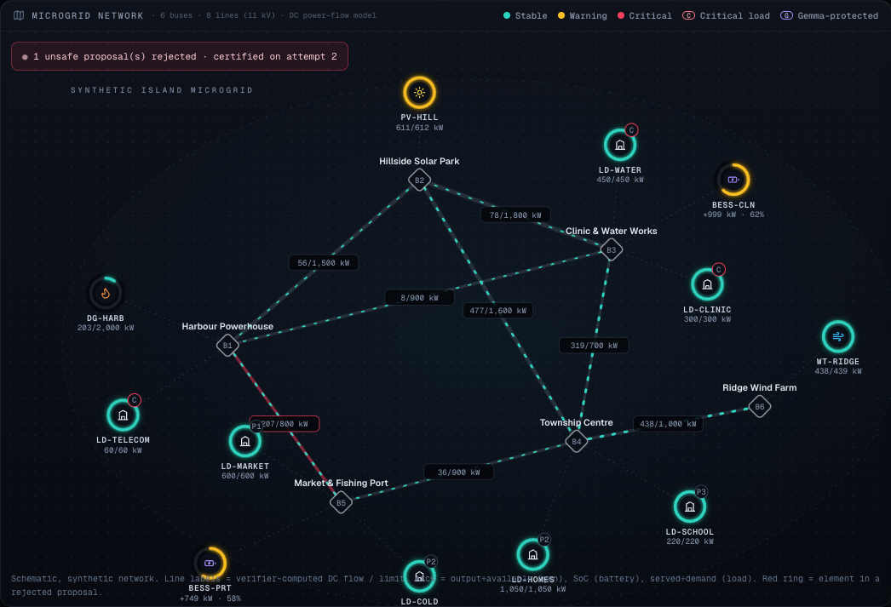
  <br><sub>The synthetic island microgrid: 6 buses, 8 power lines, solar, wind, a diesel genset, two batteries, and 7 loads (C = critical, P1–P5 = priority, G = protected by Gemma-extracted priorities).</sub>
</p>

---

## 3. ⚙️ How it works

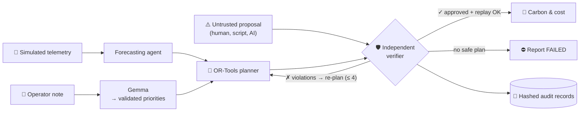

**One recovery, step by step:**

```mermaid
sequenceDiagram
  autonumber
  participant Grid as ☀️ Grid (simulated)
  participant Prop as ⚠️ Unsafe proposal
  participant Ver as 🛡️ Verifier
  participant Opt as 🧮 OR-Tools
  participant Log as 🔗 Audit ledger
  Grid->>Ver: solar −75 % (−1,836 kW)
  Prop->>Ver: diesel 2,699 kW + charge port battery
  Ver->>Ver: recompute line flows itself
  Ver-->>Log: REJECTED · 3 violations (hashed)
  Ver->>Opt: counter-example → cuts
  Opt->>Ver: batteries + 203 kW diesel
  Ver-->>Log: CERTIFIED · 27/27 checks (hashed)
  Log->>Ver: replay record → same verdict ✓
```

**Why the checker is independent:** it shares no code with the planner, uses only the Python standard library, never reads the planner's claimed line flows, and rejects any proposal that contains unexpected fields. It recalculates every line flow from the power injected at each bus.

---

## 4. 🌱 Impact

### The incident, measured (simulated data)

<p align="center">
  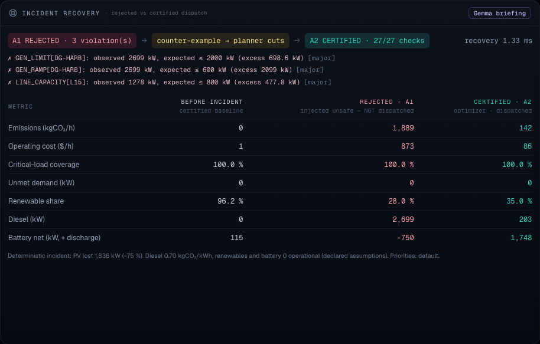
</p>

| | Before the cloud front | ❌ Rejected plan *(never dispatched)* | ✅ Certified recovery |
|---|---:|---:|---:|
| CO₂ emissions (kg/h) | 0 | 1,889 | **142** |
| Operating cost ($/h) | 1 | 873 | **86** |
| Critical loads served | 100 % | 100 % | **100 %** |
| Unmet demand (kW) | 0 | 0 | **0** |
| Renewable share | 96 % | 28 % | 35 % |

Compared with the plan it rejected, the certified plan avoids **≈ 1,750 kg CO₂ per hour** of the incident and costs **≈ $790/h less**, without cutting power to any load.

### And when there is no safe answer

<p align="center">
  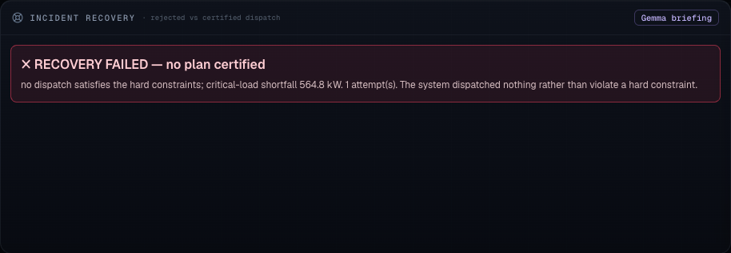
</p>

In the stress test (night, no wind, nearly empty batteries, diesel trip), **no plan can keep the clinic, water and radio powered**. SynapseGrid reports a **564.8 kW critical shortfall** and dispatches nothing, instead of hiding the problem.

### Who benefits if this is developed further

- 🏥 **Communities on island and remote grids:** fewer outages of clinics, water pumping and emergency communications during sudden renewable drops, and less diesel burned.
- 👷 **Microgrid operators:** a second check that explains *why* a plan is unsafe, in exact constraint terms, before anything is switched.
- 🤖 **Anyone putting AI into infrastructure:** a working pattern where AI handles messy human context but a deterministic check has the final say.

> [!NOTE]
> **Reading these numbers honestly**
> - All figures come from simulated data and declared assumptions: diesel 0.70 kg CO₂/kWh and $320/MWh; solar, wind and batteries 0 operational emissions. They are not field measurements.
> - The emissions comparison is against the rejected plan, not a real-world baseline.
> - "Safe" means *within the modeled constraints*. The model doesn't cover voltage, reactive power or stability.

---

## 5. 🔬 Evidence: randomized fault testing

<p align="center">
  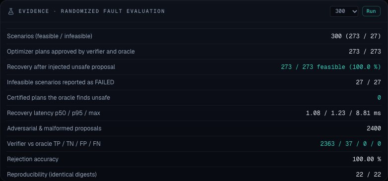
</p>

300 seeded scenarios mixing solar loss, wind, demand swings, battery levels, line outages and diesel trips (10 % deliberately extreme). Reproduce with `python app/evaluation.py --n 300 --seed 7`; full output in [`app/EVALUATION.md`](app/EVALUATION.md).

| Metric | Result |
|---|:---:|
| Recovered to a certified plan after an unsafe proposal was injected | **273 / 273** |
| Impossible scenarios reported as FAILED (never certified) | **27 / 27** |
| Certified plans that turned out to be unsafe | **0** |
| Adversarial and malformed proposals classified the same as a second, separately written checker | **2,400 / 2,400** |
| Identical results when re-run | **22 / 22** |
| Recovery time (median / 95th percentile) | **1.1 ms / 1.2 ms** |

<sub>The second checker is an OR-Tools feasibility check written separately from the verifier. Both use the same constraint definitions, so agreement shows the code is **consistent**, not that the physics model is complete. Most test proposals are unsafe by design, so only 37 were safe ones.</sub>

---

## 6. ✅ Feasibility

| | |
|---|---|
| **Runs today** | The full prototype runs on a laptop or a single 1-vCPU Cloud Run instance. The optimizer solves in ≈ 0.2 ms and the checker runs in ≈ 0.1 ms for this network. |
| **Small, open stack** | FastAPI · Pydantic · httpx · Jinja2 · Google OR-Tools, all pinned in [`app/requirements.txt`](app/requirements.txt). |
| **Tested** | 36 automated tests: valid plans, line overloads, battery limits and depletion, solar loss with recovery, honest failure, malformed and adversarial inputs, Gemma timeouts and invalid output, reproducibility, and API validation. |
| **Safe without the AI** | If Gemma is missing, slow, or returns invalid output, the app says so and falls back to declared defaults. Safety never depends on the model. |

## 7. 📈 Scalability

**Built to scale**
- The network is plain data ([`app/grid.py`](app/grid.py)). A different microgrid means a different data file, not new code.
- Planning and checking are linear-algebra and LP workloads that grow polynomially with network size, and community microgrids are small.
- One isolated Cloud Run service per community.

**Next steps (not done yet)**
- **Telemetry:** real measurements (e.g. Pub/Sub / IoT ingestion) instead of the simulator.
- **Look-ahead:** multi-hour planning so batteries aren't drained too eagerly.
- **Physics:** voltage and reactive-power checks.
- **Audit storage:** persistent storage (e.g. Firestore).
- **Validation:** with a utility partner and a power-systems engineer.

---

## 8. 🔧 Google technology used

| Technology | Where | Role |
|---|---|---|
| **Gemma** (Google AI Studio, or self-hosted via Ollama / vLLM) | [`app/gemma.py`](app/gemma.py) | Turns the operator's incident note into validated load priorities; optional plain-language briefing |
| **Google OR-Tools** (GLOP linear solver) | [`app/optimizer.py`](app/optimizer.py) | DC optimal power flow: the dispatch plan; also the separate checker in the evaluation |
| **Google Cloud Run** | [`app/Dockerfile`](app/Dockerfile) | Hosting the FastAPI app and dashboard |
| **Cloud Build + Artifact Registry** | [`cloudbuild.yaml`](cloudbuild.yaml) | Test, build, push and deploy pipeline |
| **Secret Manager** | [`cloudbuild.yaml`](cloudbuild.yaml) | Storing the Gemma API key (never in env files or source) |

<sub>Not used (and not claimed): Google Cloud Pub/Sub (the event stream is an in-process bus) and the NeuroSAN runtime (the agent pipeline is a custom asyncio DAG inspired by it).</sub>

---

## 9. 🖥️ Inside the dashboard

| Constraint inspector | Agent execution trace |
|:---:|:---:|
| 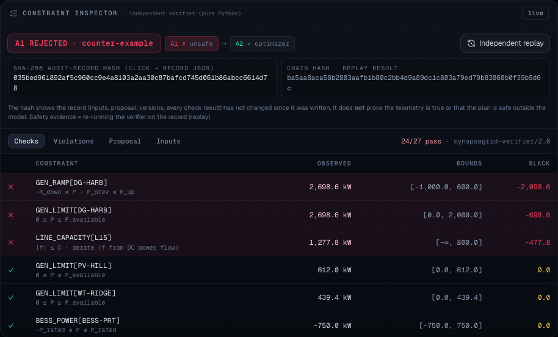 | 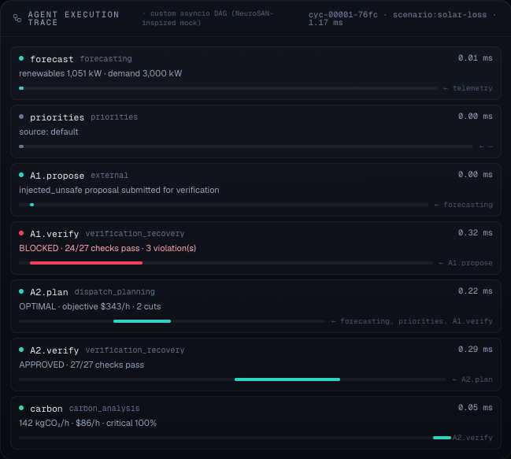 |
| Every check with observed value, bounds and slack; violations as structured records; one-click independent replay | Each agent step with its dependencies, timing and outcome |

| Hash-chained audit ledger | Full dashboard |
|:---:|:---:|
| 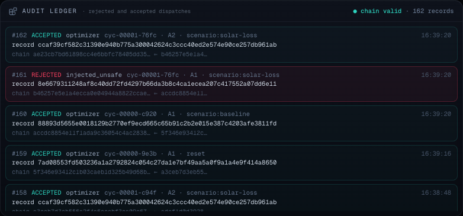 | 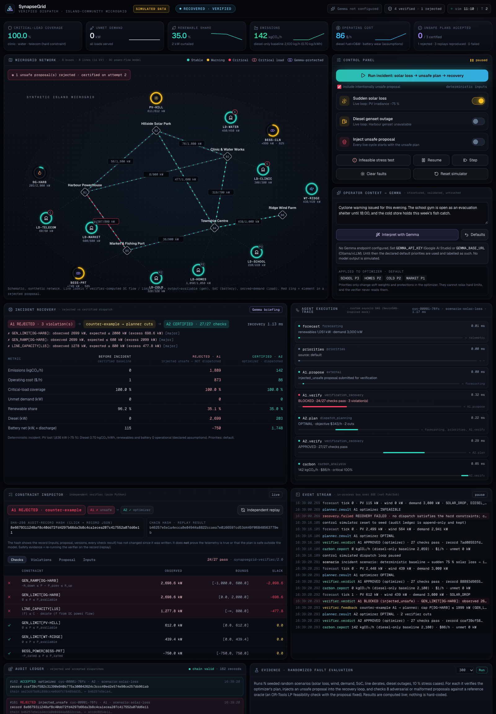 |
| Rejected and accepted dispatches, each with its SHA-256 record hash | Map, controls, Gemma panel, recovery, inspector, events, ledger, evidence |

> [!TIP]
> **What the hash does and doesn't prove.** A record hash shows that the record (inputs, proposal, versions, every check result) hasn't changed since it was written. It does **not** prove the telemetry was true or that the plan is safe in the real world. The safety evidence is **replay**: re-running the checker on the saved record.
> ```bash
> curl -s localhost:8080/api/audit/<record_hash> > record.json && python app/verifier.py record.json
> ```

---

## 10. 🛠️ Development

### Run locally

```bash
cd app
python3.12 -m venv .venv && source .venv/bin/activate
pip install -r requirements-dev.txt
pytest -q                              # 36 tests
python evaluation.py --n 300 --seed 7  # randomized evidence
python main.py                         # → http://localhost:8080   (API docs: /docs)
```

Then click **"Run incident: solar loss → unsafe plan → recovery"**.

<details>
<summary><b>Enable Gemma</b></summary>

| Option | Environment |
|---|---|
| Google AI Studio | `GEMMA_API_KEY=<your key>` (default model `gemma-4-26b-a4b-it`; override with `GEMMA_MODEL` if your key lists a different Gemma model) |
| Local Ollama | `GEMMA_BASE_URL=http://localhost:11434/v1  GEMMA_MODEL=gemma3:4b` |
| Self-hosted (vLLM, Cloud Run GPU) | `GEMMA_BASE_URL=https://<endpoint>/v1  GEMMA_MODEL=<name>` |

Every Gemma call is labelled with its real outcome (`inference`, `rejected`, `unavailable` or `not_configured`). No model output is ever simulated.
</details>

<details>
<summary><b>Project structure</b></summary>

| File | Purpose |
|---|---|
| [`app/grid.py`](app/grid.py) | Synthetic network, declared assumptions, telemetry simulator, fixed demo scenario |
| [`app/optimizer.py`](app/optimizer.py) | OR-Tools DC optimal power flow; deterministic unsafe-proposal generator |
| [`app/verifier.py`](app/verifier.py) | Independent checker (standard library only), structured violations, replay CLI |
| [`app/gemma.py`](app/gemma.py) | Gemma client, output schema, honest status reporting |
| [`app/agents.py`](app/agents.py) | Agent contracts, execution trace, bounded recovery loop, audit ledger |
| [`app/evaluation.py`](app/evaluation.py) | Randomized fault evaluation |
| [`app/main.py`](app/main.py) | FastAPI server, REST API, live event stream |
| [`app/static/index.html`](app/static/index.html) | Dashboard |

The technical deep dive (optimization formulation, full constraint list, audit-record format, API reference) is in [`app/README.md`](app/README.md).
</details>

---

## 11. ☁️ Google Cloud deployment

```text
 git push ──▶ GitHub Actions CI ── pytest (36 tests) · 300-scenario evaluation · docker build + /health smoke test
 gcloud builds submit ──▶ Cloud Build (cloudbuild.yaml)
                           ├─ test      python:3.12 · pytest
                           ├─ build     docker build app/
                           ├─ push      Artifact Registry  <region>-docker.pkg.dev/<project>/synapsegrid/synapsegrid
                           └─ deploy    Cloud Run service "synapsegrid"
                                          ├─ FastAPI + dashboard (port 8080, /health)
                                          ├─ OR-Tools planner + independent verifier (in-process)
                                          └─ GEMMA_API_KEY ◀── Secret Manager ──▶ Gemma via Google AI Studio (HTTPS)
```

**One-time setup**

```bash
gcloud config set project <PROJECT_ID>
gcloud services enable run.googleapis.com cloudbuild.googleapis.com artifactregistry.googleapis.com secretmanager.googleapis.com
gcloud artifacts repositories create synapsegrid --repository-format=docker --location=asia-southeast1

# Gemma key (optional; without it the app runs and reports Gemma as "not configured")
printf '%s' "<GEMMA_API_KEY>" | gcloud secrets create gemma-api-key --data-file=-

# Let the build service account deploy and read the secret
PROJECT_NUMBER=$(gcloud projects describe <PROJECT_ID> --format='value(projectNumber)')
SA="${PROJECT_NUMBER}-compute@developer.gserviceaccount.com"
for role in run.admin iam.serviceAccountUser artifactregistry.writer secretmanager.secretAccessor secretmanager.viewer logging.logWriter; do
  gcloud projects add-iam-policy-binding <PROJECT_ID> --member="serviceAccount:${SA}" --role="roles/${role}"
done
```

**Deploy**

```bash
gcloud builds submit --config cloudbuild.yaml
gcloud run services describe synapsegrid --region asia-southeast1 --format='value(status.url)'
```

| Setting | Why |
|---|---|
| `--min-instances 1 --max-instances 1` | Simulator state and the audit ledger are in memory, so everyone must share one always-on instance (this bills while idle; delete the service after judging) |
| `--no-cpu-throttling` | Keeps the simulated dispatch loop running between requests |
| `--timeout 3600` | Long-lived SSE connection for the live dashboard |
| `--set-secrets` (not `--set-env-vars`) | The Gemma key never appears in the build config, logs or source |

> [!NOTE]
> **Status:** the configuration is in the repo, and CI builds and smoke-tests the container on every push. The Cloud Run deployment itself has not been run yet. The live URL will be added at the top of this README once it is.

---

## 12. ⚠️ Known limitations

- **Simulation only.** The data is synthetic and the network illustrative; there is no real-grid integration.
- **Simplified physics.** Lossless DC power flow over a single 15-minute interval. No voltage, reactive power, protection or stability modelling, and no multi-hour look-ahead.
- **Assumed numbers.** Emission factors and costs are assumptions, stated in [`app/grid.py`](app/grid.py).
- **Gemma is the slow step.** In a live check (18 Oct 2026, `gemma-4-26b-a4b-it` via Google AI Studio), interpreting a note took ≈ 6 s and a briefing ≈ 4–6 s, versus under 1 ms for planning and verification. The automated tests use mocked responses.
- **Not yet deployed.** The Cloud Run deployment hasn't been run. CI builds and smoke-tests the Docker image.
- **Not a formal proof.** "Certified" means every modeled constraint holds under the stated assumptions.

---

## 13. 📋 Submission checklist

| Requirement | Status |
|---|---|
| Category specified | ✅ **Sustainability** |
| Problem, community benefit, feasibility, scalability | ✅ Sections 1, 4, 6, 7 of this README |
| Functional prototype using Google AI tools | ✅ Gemma + OR-Tools, runs locally (see section 10) |
| Deployed on Cloud Run / GCP / Firebase | ⬜ `cloudbuild.yaml` ready (section 11); URL to be added after deploying |
| Public 3-minute demo video | ✅ [Loom](https://www.loom.com/share/5062c49df951400abe2b761341c9c24a) (also [`docs/video/SynapseGrid-Demo.mp4`](docs/video/SynapseGrid-Demo.mp4), 2:59) |
| Proposal deck (PDF) | ✅ [SynapseGrid-Proposal.pdf](SynapseGrid-Proposal.pdf) (editable [PPTX](SynapseGrid-Proposal.pptx)) |
