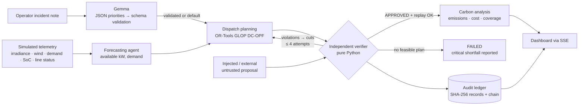

# SynapseGrid: verified renewable dispatch for critical community loads

**AI-assisted dispatch simulator for an island-community microgrid.** An OR-Tools optimizer plans each 15-minute dispatch. An **independent verifier** then re-checks every proposal against the physical limits. Unsafe plans are rejected with a structured counter-example, and the system re-plans within a bounded number of attempts. If no safe plan exists, it reports failure instead of pretending. **Gemma** turns the operator's free-text incident note into validated load priorities. Every decision becomes a replayable, SHA-256-hashed audit record.

> **Scope and honesty.** All telemetry is **synthetic**. The 6-bus network is illustrative, and nothing here controls real equipment. A certificate means *"every modeled constraint holds within the stated assumptions"*. It is **not** a formal proof and not a statement about any real grid. The orchestration is a custom asyncio DAG (inspired by NeuroSAN, not the NeuroSAN runtime). The event stream is an in-process bus, not Google Cloud Pub/Sub.

## The one result this project demonstrates

1. A sudden cloud front removes **75 % of PV output (−1,836 kW)** on the synthetic island grid.
2. An intentionally unsafe proposal ("restart the diesel to cover everything and top up the Port battery") is submitted.
3. The independent verifier **rejects it with 3 structured violations**:
   - `GEN_LIMIT[DG-HARB]`: 2,699 kW against a 2,000 kW limit
   - `GEN_RAMP[DG-HARB]`: +2,699 kW change against a +600 kW ramp limit
   - `LINE_CAPACITY[L15]`: 1,278 kW against an 800 kW limit (flow recomputed by the verifier from the bus injections)
4. The violations are fed back to the OR-Tools planner as cuts. The new plan passes **27/27 checks**, and its stored audit record **replays to the same verdict** in a fresh verifier run.
5. Measured impact (simulated, declared emission factors):

| | Before incident | Rejected unsafe plan (not dispatched) | Certified recovery |
|---|---:|---:|---:|
| Emissions (kgCO₂/h) | 0 | 1,889 | 142 |
| Operating cost ($/h) | 1 | 873 | 86 |
| Critical-load coverage | 100 % | 100 % | 100 % |
| Unmet demand (kW) | 0 | 0 | 0 |
| Diesel / battery net (kW) | 0 / 115 | 2,699 / −750 | 203 / 1,748 |

The scenario inputs are fixed, so record hashes are identical on every run. This is asserted in `tests/test_synapsegrid.py::test_identical_inputs_give_identical_records`.

## Architecture



| File | Responsibility |
|---|---|
| `grid.py` | Synthetic topology, declared parameters and emission factors, telemetry models, seeded simulator, deterministic scenario |
| `optimizer.py` | OR-Tools GLOP DC optimal power flow (single 15-min interval); deterministic unsafe-proposal generator |
| `verifier.py` | **Standard library only.** Input validation, DC power-flow recomputation, all hard checks, structured violations, replay, CLI |
| `gemma.py` | Gemma client (Google AI Studio or OpenAI-compatible), strict output schema, honest status reporting |
| `agents.py` | Typed agent contracts, execution DAG with traces, bounded recovery, audit ledger, event bus, scenarios |
| `evaluation.py` | Randomized fault suite with an independent LP oracle |
| `main.py` | FastAPI: dashboard, REST, SSE, simulated dispatch loop |
| `static/index.html` | Single-file dashboard (Tailwind, Lucide, SVG) |

### Optimization problem (`optimizer.py`)

- **Variables:** generator output p_g, battery discharge d_b and charge c_b, served load s_l, bus angles θ_n, line flows f_k.
- **Power balance at every bus:** Σp + Σ(d−c) − Σs = Σ outgoing f − Σ incoming f, with f_k = (θ_from − θ_to)/x_k · S_base (lossless DC power flow).
- **Hard constraints:**
  - 0 ≤ p ≤ available, plus diesel ramp limits
  - battery power within its rating, and the SoC after 15 min within [0.10, 0.95] (95 % one-way efficiency)
  - |f_k| ≤ C_k · derate_k
  - **critical loads fully served**
- **Objective ($/h):**
  - diesel fuel + O&M ($320/MWh) + carbon price ($85/t × 0.70 t/MWh)
  - + battery wear − stored-energy value of charging + stored-energy value of discharging
  - + VOLL ($2,000/MWh) × priority weight × unmet non-critical load
- **Critical-load policy:** critical loads are never traded off. If they cannot be served, the problem is **infeasible** and the system reports `FAILED` with the critical shortfall (computed by a relaxed LP). Gemma-protected loads are hard in the planner only. If protecting them makes the problem infeasible, those protections are dropped (and recorded) before the system declares failure.
- **Limitations:** single interval (myopic, no look-ahead), no unit commitment, no losses, no reactive power or voltage.

### Verifier (`verifier.py`)

It never reads the planner's claimed flows; unknown proposal keys are themselves a violation. It recomputes the bus injections, solves the DC power flow (Gaussian elimination) and checks:

| Family | Check |
|---|---|
| `INPUT_VALID` | schema, exact id sets, finite numbers, ranges, no extra keys |
| `POWER_BALANCE` | \|Σ generation + Σ battery − Σ served\| ≤ 1 kW |
| `LINE_CAPACITY` | \|f\| ≤ C · derate (f from verifier's own DC power flow) |
| `GEN_LIMIT` / `GEN_RAMP` | 0 ≤ P ≤ P_available; −R_down ≤ P − P_prev ≤ R_up |
| `BESS_POWER` / `BESS_SOC` | −P_rated ≤ P ≤ P_rated; SoC after interval within limits |
| `LOAD_BOUNDS` / `CRITICAL_LOAD` | 0 ≤ served ≤ demand; critical served = demand |
| `NETWORK` | in-service network connected |

Each violation record contains `constraint_id, family, element, element_type, observed, limit, expected, unit, excess, severity, message`.

### Gemma (`gemma.py`)

- **Task 1:** turn the operator's note (for example *"cyclone warning; school gym is the evacuation shelter"*) into JSON with `incident_summary`, `protected_loads`, `load_priority` and `rationale`.
- The output is validated by a strict Pydantic schema:
  - no extra keys
  - only known **non-critical** load ids
  - priorities are integers from 1 to 5
  - at most 4 protected loads
- Validated priorities only change the optimizer's soft weights and protections. **The verifier never reads them.**
- **Task 2 (optional):** a plain-language operator briefing built from the recorded facts.
- **Status is explicit:**
  - `inference`: a real model response was received and validated
  - `rejected`: the model answered, but the output failed validation
  - `unavailable`: timeout or HTTP error after 1 retry
  - `not_configured`: no endpoint is set

  In every case other than `inference`, the declared default priorities are used and labelled as defaults. **No model output is ever simulated.**

## Audit and reproducibility

Every proposal produces an audit record containing:
- the canonical inputs (telemetry, forecast, network, parameters)
- the proposal and its source
- the optimizer, verifier, constraint-set and prompt versions
- every check result and violation
- the impact metrics

`record_hash = SHA-256(canonical JSON)`, and records are chained: `chain_hash = SHA-256(prev_chain_hash + record_hash)`. Timestamps and random IDs are kept outside the record, so identical inputs give identical hashes.

**What the hash establishes:** the record has not changed since it was written, and the order of the chain is intact.

**What it does not establish:** that the telemetry was true, that the model is adequate, or that the plan is safe outside the model. The safety evidence is the *replay*:

```bash
curl -s localhost:8080/api/audit/<record_hash> > record.json
python verifier.py record.json      # independent re-verification; exit code 0 if reproduced
```

## Evidence: randomized fault evaluation

`python evaluation.py --n 300 --seed 7` produced the results in [EVALUATION.md](EVALUATION.md) (the full JSON is in `evaluation_results.json`):

- 300 scenarios: 273 feasible, 27 infeasible.
- The optimizer's plan was approved by both the verifier and the oracle in 273/273 feasible scenarios.
- After an injected unsafe proposal, 273/273 feasible scenarios recovered to a certified plan.
- All 27 infeasible scenarios were reported as `FAILED`, never certified.
- 0 certified plans were judged unsafe by the oracle.
- 2,400 adversarial and malformed proposals were checked: TP 2363 / TN 37 / FP 0 / FN 0.
- Recovery latency: p50 1.1 ms, p95 1.2 ms.
- 22/22 re-runs produced identical check digests.

**Methodology and caveats:**
- **The oracle** is a separately written OR-Tools LP feasibility check with the proposal held fixed. It uses the same constraint definitions, so agreement shows **implementation consistency**, not physical validity.
- **Few safe proposals:** most mutations are unsafe by construction, so the TN count is small (37). Near-boundary cases come mainly from the boundary unit tests.
- **Recovery always succeeds when feasible by design:** the optimizer models every constraint the verifier checks. The recovery loop matters most for untrusted or external proposals.

## Run locally

```bash
cd app
python3.12 -m venv .venv && source .venv/bin/activate
pip install -r requirements-dev.txt
pytest -q                                   # 35 tests
python evaluation.py --n 300 --seed 7       # randomized evidence
python main.py                              # http://localhost:8080  (API docs at /docs)
```

### Configure Gemma

| Option | Environment |
|---|---|
| Google AI Studio (hosted Gemma) | `GEMMA_API_KEY=<key from aistudio.google.com>`; optional `GEMMA_MODEL` (default `gemma-3-27b-it`; check that the model id is listed for your key) |
| Local Ollama | `ollama pull gemma3:4b`, then `GEMMA_BASE_URL=http://localhost:11434/v1 GEMMA_MODEL=gemma3:4b` |
| vLLM / Gemma on Cloud Run GPU | `GEMMA_BASE_URL=https://<service>/v1`, `GEMMA_MODEL=<served model name>`, `GEMMA_API_KEY` if the endpoint is protected |

`GEMMA_TIMEOUT_S` (default 12) bounds each call. Check the header badge and the **Operator context** panel: they show the provider and model, and the status of every call.

### Key API endpoints

| Method | Path | Purpose |
|---|---|---|
| GET | `/health` | Health check (versions, Gemma configuration, ledger chain status) |
| POST | `/api/scenarios/incident` | Deterministic solar-loss incident with optional unsafe proposal |
| POST | `/api/scenarios/infeasible` | Stress test that must fail honestly |
| POST | `/api/evaluate-load-shift` | Telemetry overrides, `inject_unsafe`, or an untrusted external `proposal` |
| POST | `/api/inject-grid-fault` | `solar_loss`, `diesel_outage`, `unsafe_proposal`, `all_clear` |
| POST | `/api/gemma/priorities` · `/api/gemma/briefing` | Gemma tasks |
| GET | `/api/audit/{hash}` · `/api/replay/{hash}` · POST `/api/replay` | Audit record and independent replay |
| POST | `/api/evaluation` | Run the randomized suite (n ≤ 1000) |

## Deploy to Google Cloud Run

```bash
gcloud config set project <PROJECT_ID>
gcloud services enable run.googleapis.com cloudbuild.googleapis.com artifactregistry.googleapis.com secretmanager.googleapis.com

# Gemma key as a secret (skip for offline mode)
printf '%s' "<GEMMA_API_KEY>" | gcloud secrets create gemma-api-key --data-file=-
PROJECT_NUMBER=$(gcloud projects describe <PROJECT_ID> --format='value(projectNumber)')
gcloud secrets add-iam-policy-binding gemma-api-key \
  --member="serviceAccount:${PROJECT_NUMBER}-compute@developer.gserviceaccount.com" --role=roles/secretmanager.secretAccessor

cd app
gcloud run deploy synapsegrid --source . --region asia-southeast1 --allow-unauthenticated \
  --port 8080 --cpu 1 --memory 1Gi --min-instances 1 --max-instances 1 --no-cpu-throttling --timeout 3600 \
  --set-secrets GEMMA_API_KEY=gemma-api-key:latest
```

- `--max-instances 1`: the simulator state and the ledger are in memory, so all viewers must share one instance.
- `--min-instances 1 --no-cpu-throttling`: keeps the dispatch loop running between requests. This costs money even while idle, so delete the service afterwards.
- `--timeout 3600`: allows long-lived SSE connections.
- Credentials come only from environment variables and Secret Manager. Nothing is in the source code.

## Known limitations

- Synthetic data and an illustrative topology. The model is lossless DC power flow over a single 15-minute interval. There's no voltage, reactive power, protection or transient-stability modelling, no unit commitment, and no multi-period look-ahead (so batteries are dispatched myopically).
- Emission factors and costs are declared assumptions (diesel 0.70 kgCO₂/kWh; renewables and batteries 0 operational, lifecycle emissions excluded).
- The audit ledger is in memory. Persisting it (for example to Firestore, or by publishing chain heads) would be needed for a real tamper-evident trail.
- Gemma has been exercised in tests only against mocked HTTP responses (valid, malformed, hallucinated IDs, timeouts). A live call needs your key or endpoint, and then a manual check.
- The Docker image has not been built in this environment (no Docker). The pinned requirements were tested in a clean virtualenv.

## Three-minute demo script

| Time | Do this | Say this |
|---|---|---|
| 0:00 | Show the header: **SIMULATED DATA** badge and status. | "Island communities run on diesel. Solar + storage cuts emissions, but a cloud front can drop 75 % of PV in minutes, and the clinic, water pumps and radio can't go dark." |
| 0:25 | Type the cyclone note, then click **Interpret with Gemma** (needs a configured Gemma endpoint). | "Gemma reads the operator's note and returns priorities as JSON. We validate it like any untrusted input: wrong or critical IDs are rejected. The school is protected as a shelter." |
| 0:55 | Click **Run incident**. | "A deterministic incident: PV loses 1,836 kW. Someone proposes restarting the diesel to cover everything." |
| 1:10 | Point to the recovery panel and the red ring on L15. | "The independent verifier rejects it: the genset is over its 2 MW rating, it breaks the 600 kW ramp limit, and line L15 would carry 1,278 kW on an 800 kW line. The verifier computed that flow itself; it never trusts the planner." |
| 1:40 | Show the A1 ✗ → A2 ✓ chips and the before/rejected/certified table. | "The violations go back to the OR-Tools optimizer. The second plan passes all 27 checks in about a millisecond. Critical coverage stays at 100 %, and emissions are 142 kg/h instead of 1,889 for the rejected plan." |
| 2:05 | Click **Independent replay**, then open the record hash. | "Every decision is a hashed audit record. Replay re-runs the verifier on it. The hash proves the record is unchanged; the replay is the safety evidence." |
| 2:25 | Click **Infeasible stress test**. | "When there is no safe plan (night, no wind, empty batteries, diesel trip), it says so: 565 kW of critical shortfall, and nothing is dispatched." |
| 2:40 | Click **Evidence → Run**. | "Across 300 random faults: 0 unsafe plans accepted, 2,400 adversarial proposals all classified the same as an independent oracle, and every infeasible case is reported honestly." |
| 2:55 | Close. | "Gemma reads the human context, the optimizer plans, and an independent verifier decides." |
